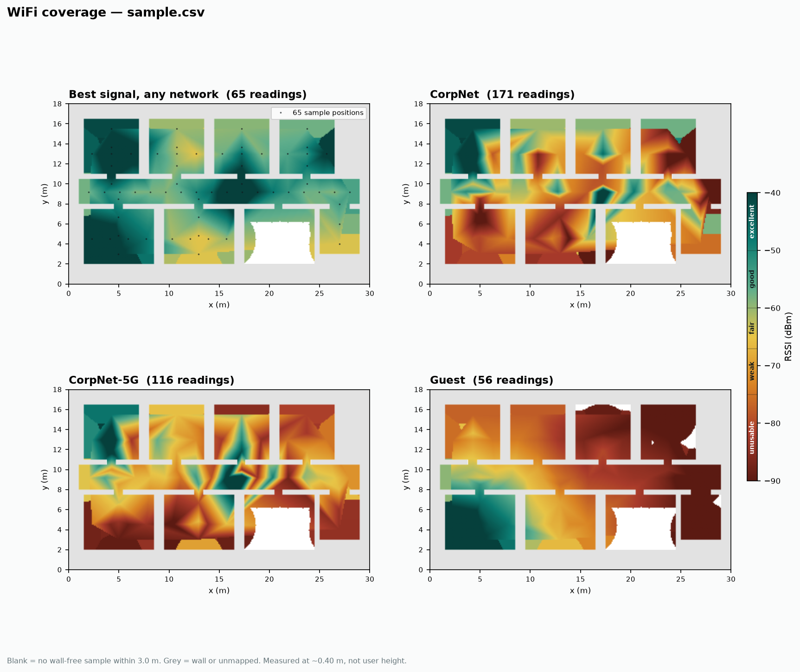

# go2-rf-survey

Autonomous WiFi site surveying with a Unitree Go2 EDU. The robot maps a floor with
LiDAR, then walks it again recording signal strength at every waypoint, producing
per-SSID heatmaps registered to the SLAM floorplan.

**Status:** phase 0, pending hardware access. The measurement and
post-processing halves are written and tested — see
[What works today](#what-works-today).

> ### ▶ Resume here
>
> **Phase 0 done** (2026-10-20, `docs/survey-2026-10-20.txt`): SSH over `eth0`
> confirmed, Docker 24.0.5 with the NVIDIA runtime registered, Foxy stock →
> Humble container ([D1](docs/plan.md)), kernel 5.10 / JetPack 5.1.1, 429 GB
> free.
>
> **Next action:** connect the Mid-360, then build and launch the container:
>
> ```bash
> ssh unitree@192.168.123.18
> git clone https://github.com/daTechGuy/go2-rf-survey.git && cd go2-rf-survey
> docker build -t go2-survey:humble docker/ && IFACE=eth0 bash docker/run.sh
> ```
>
> The DDS interface is `eth0`; the Mid-360's real IP is the one placeholder left
> until the sensor is plugged. Full steps: **[docs/RUNBOOK.md](docs/RUNBOOK.md)**.
>
> **No robot to hand?** Part 0 of the runbook works on any machine:
> `python tools/run_tests.py`, then render a heatmap from synthetic data.

---

## Hardware

| Component | Part | Notes |
|---|---|---|
| Platform | Unitree Go2 EDU | Jetson Orin, `192.168.123.18` |
| LiDAR | Livox Mid-360 | 360° × 59° (−7° to +52°), 200k pts/s, built-in IMU |
| Depth | Intel RealSense D435i | near-field obstacles inside the LiDAR blind zone |
| WiFi scan | **MT7612U** USB adapter | Netgear A6210 or Alfa AWUS036ACM — see below |

### The WiFi adapter is not an obvious choice

Throughput is irrelevant — it only ever scans. What matters is a driver on
**the Jetson's kernel (5.10)**, and Docker shares the host kernel so a
container does not help.

| Chipset | Mainline since | On 5.10 |
|---|---|---|
| **MT7612U** (`mt76x2u`) | 4.19 | ✅ plug and play |
| MT7921AU | 5.18 | ❌ too new |
| RTL8812BU | 6.12 | ❌ far too new |
| RTL8812AU / **8814AU** | never | ❌ DKMS |

This inverts the usual advice: MT7921AU is the newer, better adapter and is
useless here. **Avoid anything sold as AC1750 / AC1900** — those classes are
almost all RTL8814AU. Verify `lsusb` shows `0e8d:7612` before buying; vendors
change chipsets between hardware revisions under one model name.

It must also be **separate from the robot's own link** (R2) and have a
**fixed, non-articulating antenna** (R5).

Full detail, including a tested-and-rejected adapter:
**[docs/HARDWARE.md](docs/HARDWARE.md)**

## How it works

```
Mid-360 ──► livox_ros_driver2 ──► FAST-LIO2 ──┬──► Nav2 ──► /cmd_vel ──► SportClient ──► robot
                                              │
D435i ──► realsense2_camera ──────────────────┤ (obstacle layer)
                                              │
USB WiFi ──► iw scan ──► wifi_survey ◄─────────┘ (pose at scan time)
                              │
                              └──► survey.csv ──► heatmap
```

The SLAM pose is consumed twice — Nav2 needs it to drive, the survey node needs it
to geotag a scan. There is no independent localisation path for the WiFi data, so
odometry drift shows up directly as a smeared heatmap.

## Output schema

One row per access point per sample position:

| Field | Example | Source |
|---|---|---|
| `stamp` | `1760932481.204` | ROS clock at scan **completion** (see [D4](docs/plan.md)) |
| `sample_id` | `42` | groups the rows of one sweep; groups rotate-and-average sets |
| `x`, `y`, `z` | `14.82, -3.07, 0.40` | TF `map` → `base_link` |
| `yaw` | `1.571` | same transform — required, see [R5](#risks) |
| `bssid` | `3c:37:86:a1:b2:c3` | `iw scan` |
| `ssid` | `CorpNet` | `iw scan`; empty for hidden networks, which are still recorded |
| `freq` | `5180` | `iw scan` |
| `band` | `5` | derived — `2.4` / `5` / `6` |
| `rssi` | `-67.0` | the measurement |

---

## What works today

Everything that doesn't need the robot is written and verified ahead of
hardware access.

```bash
bash tools/run_tests.sh
# 85 tests passed across 4 suites
```

Plain stdlib `unittest` — no ROS, no radio, no robot, no numpy. That's
deliberate: the parts most likely to be quietly wrong (`iw` output parsing,
velocity limiting, the watchdog) are pure functions precisely so they can be
pinned before the hardware exists. `colcon test` picks them up too.

### `go2_survey_wifi` — the ROS 2 node

Scans on a dedicated adapter, looks up the SLAM pose at scan completion, writes
rows. Two modes:

```bash
# phase 5: teleop-drive and sample every metre of travel
ros2 launch go2_survey_wifi survey.launch.py \
    interface:=wlan1 output_csv:=$HOME/surveys/floor1.csv

# phase 8: scan only when the waypoint follower says the robot is at rest
ros2 launch go2_survey_wifi survey.launch.py mode:=triggered
ros2 service call /wifi_survey/scan_now std_srvs/srv/Trigger
```

Rows flush to disk as produced — a flat battery costs the last sample, not the
run. Samples whose pose is staler than `max_tf_age_s` are discarded rather than
silently misplaced on the map.

The `iw` parser is a pure function with **18 unit tests** covering hidden SSIDs,
the `-- associated` suffix, fractional RSSI, channel-only output from older `iw`
versions, and malformed blocks that must not take good blocks down with them.

There's also a standalone adapter check, to confirm a radio works before ROS is
in the picture:

```bash
python -m go2_survey_wifi.scanner wlan1
```

### `go2_survey_bridge` — `/cmd_vel` → sport mode

Phase 6. Subscribes `geometry_msgs/Twist`, publishes `unitree_api/msg/Request`
on `/api/sport/request`.

It talks to the robot **through `unitree_ros2`'s topic, not by linking
`unitree_sdk2`**. That means no C++ build against an external SDK, no
`ChannelFactory`/network-interface handling in our code, and — the reason it
matters most — the safety logic is a pure state machine with tests.

Three guards, each for a different failure:

| Guard | Failure it catches | Default |
|---|---|---|
| **clamp** | a planner emitting nonsense (Nav2 misconfigured to 2 m/s) | 0.6 / 0.4 m/s, 0.8 rad/s |
| **slew** | an abrupt but legitimate setpoint — a quadruped stumbles on a velocity step where a wheeled robot wouldn't | 0.8 m/s², 1.6 rad/s² |
| **watchdog** | the planner dying, network dropping, container being killed | stop after 0.3 s of silence |

Plus a latching e-stop. `~/clear_estop` deliberately does **not** resume
motion — the next `/cmd_vel` does, ramping from rest. Clearing an e-stop must
never itself move a robot.

```bash
source ~/unitree_ros2/setup.sh
ros2 launch go2_survey_bridge bridge.launch.py
```

**Verify the watchdog before trusting this to a planner.** With the robot on a
stand:

```bash
ros2 service call /go2_cmd_bridge/balance_stand std_srvs/srv/Trigger
ros2 topic pub -r 20 /cmd_vel geometry_msgs/msg/Twist '{linear: {x: 0.2}}'
# Ctrl-C the publisher — the robot must stop within cmd_timeout_s.
# If it doesn't, do not proceed to Nav2.
```

Services: `~/stand_up`, `~/balance_stand`, `~/stop`, `~/damp`,
`~/recovery_stand`, `~/estop`, `~/clear_estop`. `~/damp` works even under
e-stop — it's the safest terminal state, and a latch that blocks it would
prevent the one command most likely wanted in an emergency.

### `tools/` — post-processing

Runs off-robot; `pip install -r tools/requirements.txt`, no ROS.

```bash
# generate a synthetic floorplan + survey with known ground truth
python tools/make_synthetic_survey.py --out docs/sample

# render it
python tools/heatmap.py docs/sample.csv --map docs/sample.yaml --out docs/
python tools/heatmap.py docs/sample.csv --map docs/sample.yaml --band 5 --out docs/
```



*Synthetic data — a log-distance propagation model over a generated floorplan,
not a real building. It exists so the rendering chain is provably correct before
the robot produces anything.*

Two masks are applied, and both matter:

- **occupancy** — walls and unmapped cells are never coloured
- **sample distance** — cells further than `--max-reach` from a real sample are
  left blank. Without this, `griddata` fills rooms the robot never entered,
  which is the most misleading thing a survey tool can do. The white area in
  the lower middle of the sample is exactly that: a room left unvisited on
  purpose to exercise the mask.

Known limitation: the distance mask is euclidean, not geodesic, so two rooms
sampled either side of a thin wall can bleed through it. Fixing that means a
geodesic distance transform over the free space — worth doing if the floorplans
get complicated.

---

## ⚠ Settle the mount angle before drilling anything

The Mid-360's vertical FOV is **−7° to +52°** — tilted *upward*. Mounted level at
~0.40 m, its lowest ray does not reach the floor until:

```
0.40 / tan(7°) ≈ 3.3 m ahead
```

Everything nearer than that is invisible: the floor, curbs, chair legs, descending
steps. **This fails silently** — the map looks excellent and the robot walks into
things.

| Mount pitch | Lowest ray | Ground contact | Upper FOV kept |
|---|---|---|---|
| 0° (level) | −7° | 3.26 m | 52° |
| 15° | −22° | 0.99 m | 37° |
| **22°** | **−29°** | **0.72 m** | **30°** |
| 30° | −37° | 0.53 m | 22° |

Recompute for your actual sensor height as `h / tan(pitch + 7°)`. ~22° is the
indoor sweet spot. Declare the angle **in the URDF** so the TF tree carries it —
not in `MID360_config.json`'s extrinsics — so SLAM and both costmaps agree on
where gravity points.

---

## Build sequence

Ordered by dependency. The survey capability lands at phase 5, before autonomy, so
there is a working deliverable even if Nav2 tuning stalls.

- [~] **00 · Access and inventory** — SSH in, change stock password, run `tools/go2_survey.sh`
      *Done 2026-10-20 (`docs/survey-2026-10-20.txt`): eth0, Docker + NVIDIA
      runtime, kernel 5.10 / JetPack 5.1.1. Password left at default (demo);
      `ros2 topic echo /sportmodestate` stream not yet verified.*
- [ ] **01 · Choose the ROS runtime** — Humble in a `--network host` container over native Foxy
      *Exit: unitree_ros2 topics visible from inside the container*
- [ ] **02 · Mid-360 bring-up** — Livox-SDK2 + `livox_ros_driver2`, resolve the subnet collision
      *Exit: `/livox/lidar` renders a recognisable room in RViz*
- [ ] **03 · Mount geometry and TF tree** — pitch ~22° down, write the URDF
      *Exit: floor reads flat and level in `base_link`; walls vertical*
- [ ] **04 · LiDAR-inertial SLAM** — FAST-LIO2 with Mid-360 params
      *Exit: walk a loop and return, drift under ~1% of path length*
- [ ] **05 · WiFi survey node** ← **deliverable**
      *Exit: per-SSID heatmap of one floor, registered to the SLAM map*
- [ ] **06 · Velocity bridge** — `/cmd_vel` → `Move(vx, vy, vyaw)`, with a watchdog
      *Exit: robot tracks `/cmd_vel`; halts within 300 ms of silence*
- [ ] **07 · Depth camera and costmaps** — decimate hard, feed the local costmap
      *Exit: a box on the floor at 0.5 m appears in the local costmap*
- [ ] **08 · Nav2 and the waypoint route** — the long pole
      *Exit: unattended 20-waypoint route, zero interventions, twice*

### Documentation

| | |
|---|---|
| **[RUNBOOK.md](docs/RUNBOOK.md)** | **What to type, in order, to get a heatmap.** Start here. |
| [HARDWARE.md](docs/HARDWARE.md) | What to buy and what to avoid — especially the WiFi adapter |
| [BUILD_PLAN.md](docs/BUILD_PLAN.md) | Nine phases with exit criteria and the risk register |
| [plan.md](docs/plan.md) | Derivations and decision records (D1–D4) |

### On exploration

Resist live frontier exploration. Teleop-drive the map once with a human present,
save it, then survey against known geometry. Mapping and surveying in one
autonomous pass is where projects like this stall.

---

## Risks

| | Risk | Mitigation |
|---|---|---|
| **R1** | **LiDAR sees through glass.** Glass doors and partitions return nothing, won't appear in the map, and Nav2 will plan through them. | Annotate glass as keep-out zones in the saved map. Keep the collision monitor tight. |
| **R2** | **Scanning tears down your own WiFi link.** A full `iw scan` channel-hops and drops association for 2–5 s — losing your SSH session mid-survey. | A second USB adapter dedicated to scanning. ~$20, eliminates the failure class. |
| **R3** | **Mount angle blinds the near field.** Invisible in map quality; shows up only as collisions. | Phase 3, resolved once, in the URDF. |
| **R4** | **Scan duration smears samples.** 2–5 s at 0.5 m/s averages 1–2.5 m of travel into one "point". | Stop-and-scan at waypoints. |
| **R5** | **RSSI depends on heading.** Chassis and battery attenuate; 5–10 dB across 180° of rotation. | Rotate-and-average, 4 scans at 90°. At minimum log yaw. |
| **R6** | **Battery won't cover a floor.** 1–1.5 h walking, less with full compute. | Resumable route segments with a persisted index. |
| **R7** | **0.40 m is not user height.** Relative coverage transfers; absolute dBm at 1–1.5 m does not. | Only if you need absolute numbers — a light mast for the antenna alone. |
| **R8** | **The robot biases its own measurement.** USB 3.0 raises the 2.4 GHz noise floor ~20 dB ([Intel](https://www.usb.org/sites/default/files/327216.pdf)), and the D435i runs inches from the scanning antenna. 2.4 GHz reads low, 5 GHz looks fine, and the heatmap shows a dead zone that is actually the robot. | USB 2.0 port, physical separation, and characterise it once — see [BUILD_PLAN](docs/BUILD_PLAN.md#r8-in-detail--the-robot-interferes-with-its-own-instrument). |

---

## Quickstart (phase 0)

Static IP on your wired adapter, then SSH:

```powershell
# Windows, PowerShell as admin
Get-NetAdapter                    # find the right InterfaceAlias
New-NetIPAddress -InterfaceAlias "Ethernet" -IPAddress 192.168.123.222 -PrefixLength 24
```

```bash
ping 192.168.123.18
ssh unitree@192.168.123.18        # stock password: 123 — change it immediately
```

| Address | What | Access |
|---|---|---|
| `192.168.123.18` | Jetson Orin — dev target | `unitree` / `123` |
| `192.168.123.161` | MCU / motion controller | no SSH |
| `192.168.123.222` | your laptop | — |

If ping fails it's almost always Windows routing over WiFi instead of the wired
link. Turn WiFi off for the first connection.

Then run the inventory script on the robot:

```bash
bash tools/go2_survey.sh 2>&1 | tee docs/survey-$(date +%F).txt
```

It is read-only and changes nothing.

## Unknowns to resolve in phase 0

| Question | How to answer | What it decides |
|---|---|---|
| JetPack / Ubuntu / ROS version | `lsb_release -a` | Foxy native vs. Humble container |
| Docker present, NVIDIA runtime? | `docker info` | Whether phase 1 is easy or a build |
| Jetson interface name | `ip -brief addr` | `CYCLONEDDS_URI` — wrong value gives silent zero topics |
| Mid-360's real IP | `tcpdump -n udp` | `MID360_config.json` and the alias subnet |
| librealsense installed? | `rs-enumerate-devices` | Phase 7 effort |
| Free disk for maps and bags | `df -h /` | Whether raw clouds can be recorded |

---

## Layout

```
go2_survey_wifi/         ✅ iw scan + TF pose join → CSV  (phase 5)
  go2_survey_wifi/
    scanner.py             iw invocation + parsing — pure, 18 tests
    survey_node.py         rclpy node, continuous + triggered modes
  launch/survey.launch.py
go2_survey_bridge/       ✅ /cmd_vel → sport mode         (phase 6)
  go2_survey_bridge/
    limits.py              clamp + slew + watchdog — pure, 31 tests
    sport_api.py           API ids + request JSON — pure, 15 tests
    bridge_node.py         rclpy node, services, e-stop
  launch/bridge.launch.py
go2_survey_description/  ✅ TF frames, 22° LiDAR mount    (phase 3)
  urdf/sensors.urdf.xacro  Mid-360 + D435i macro
  urdf/go2_survey.urdf.xacro
  launch/description.launch.py
  rviz/survey.rviz
tools/                   ✅ post-processing, runs off-robot
  occupancy.py             map_server PGM/YAML read + write
  heatmap.py               CSV + map → per-SSID heatmaps
  make_synthetic_survey.py fixture generator with ground truth
  fov_geometry.py          mount-angle maths — pure, 21 tests
  go2_survey.sh            phase-0 onboard inventory
  run_tests.sh             all suites, no dependencies
docker/                  ✅ Humble container for the Jetson (D1)
config/                  🟨 mount.yaml, MID360_config.json, FAST-LIO2 params
docs/                    BUILD_PLAN.md, plan.md, sample output
go2_survey_bringup/      ⬜ composed launch              (phase 8)
```

`go2_survey_wifi` is `ament_python` with a format-3 manifest, so it builds
unchanged on Foxy and Humble — the distro is not settled until phase 0, and
nothing here needs it to be.

## Upstream dependencies

- [unitree_sdk2](https://github.com/unitreerobotics/unitree_sdk2) — `SportClient`, low-level control
- [unitree_ros2](https://github.com/unitreerobotics/unitree_ros2) — DDS bridge (Foxy / Humble)
- [Livox-SDK2](https://github.com/Livox-SDK/Livox-SDK2) + [livox_ros_driver2](https://github.com/Livox-SDK/livox_ros_driver2) — Mid-360
- [FAST_LIO](https://github.com/hku-mars/FAST_LIO) — LiDAR-inertial odometry
- [Nav2](https://github.com/ros-navigation/navigation2) — planning and control
